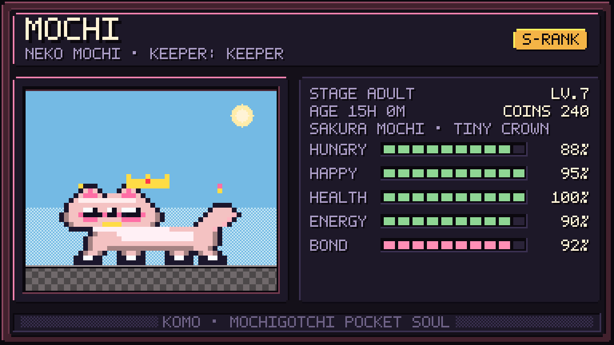
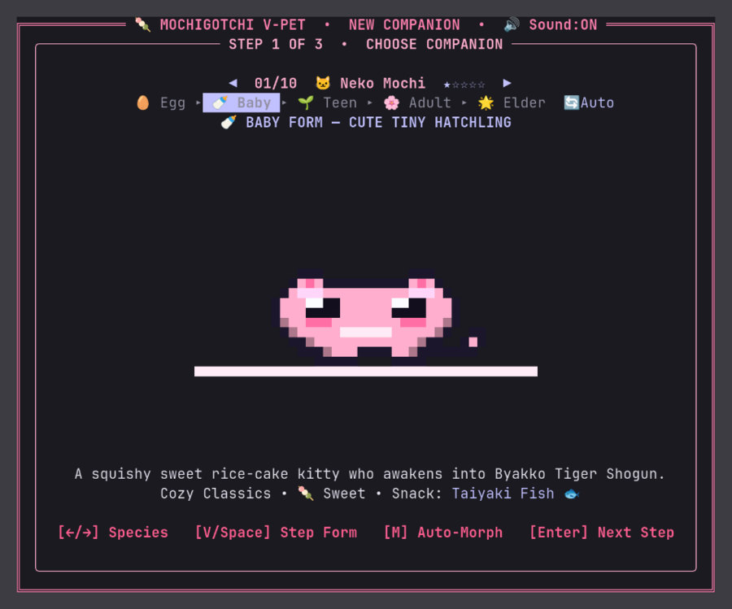
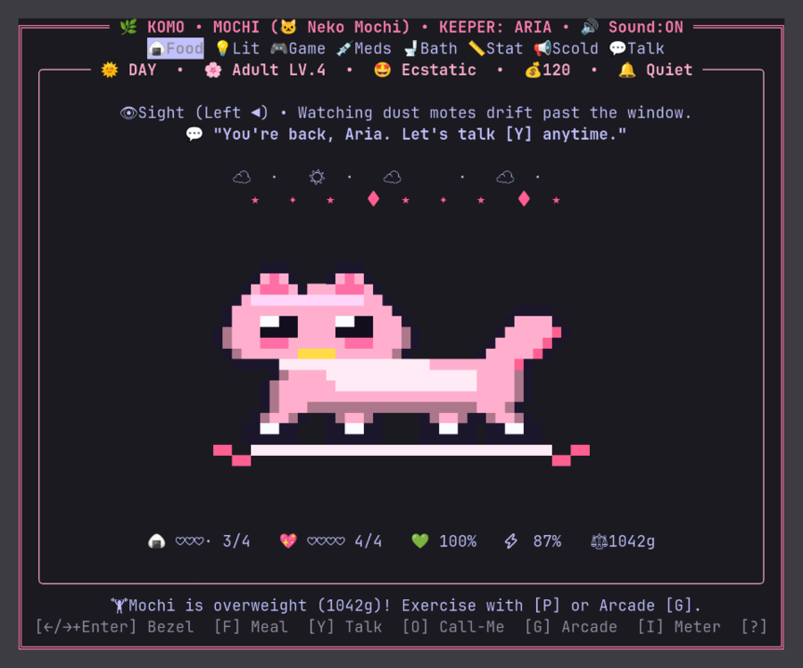

# 🌿 KOMO — a small soul that lives in your terminal

[](./LICENSE)
[](./CHANGELOG.md)
[](./Cargo.toml)
[]()

Most terminal dashboards just sit there and print your CPU temperature.
**KOMO** (*Komorebi Pocket Soul*) moves into your terminal, watches your cursor, perks an ear when you type, runs up to the front glass when you come back from lunch, and judges you if you forget to turn the room lamp off before bed.

<p align="center">
  
</p>

<p align="center">
  
  
</p>

`komo --status`, run in a real terminal:

```text
Mochi — 🐱 Neko Mochi Common ★ | Stage: 🌸 Adult | Mood: 💖 Joyful | Lv.7 (1450 XP) |
Rank: 👑 S-Rank (Perfect Keeper) | Weight: 4.35kg | Hungry: ♥♥♥♥ 4/4 (88%) • Happy:
♥♥♥♥ 4/4 (95%) • Discipline: 85% • Energy: 90% • Health: 100% • Clean: 100% •
Bond: 92% | Mistakes: 0 | Coins: 240
💭 👁 Sight (Looking at You ●) • Looking right at Keeper with steady eyes.
💬 "You're back, Keeper. Let's talk [Y] anytime."
```

## Meet the Starter Trio

You start by adopting one of three hand-crafted companions (each with 5 evolution stages, from a `120g` Egg up to a `6.50kg` Starlight Elder):

* **🐱 Neko Mochi** — A squishy sweet rice-cake kitty who loves Taiyaki Fish (`🐟`), naps on woven mats, and awakens into *Byakko Tiger Shogun*.
* **🐶 Boba Pup** — A loyal milk-tea puppy who wags his tail at the front glass, snacks on Honey Biscuits (`🦴`), and grows into *Fenrir Dire Wolf*.
* **🐰 Cloud Bun** — A cotton-soft sky bunny who munches Sweet Carrots (`🥕`) and commands storm clouds as *Raijin Valkyrie*.

## Why Keepers Fall in Love With It (and Occasionally Panic)

* **🏡 They actually welcome you home.** Close your laptop for lunch or a night's sleep. When you open `komo` again, your companion won't randomly drop dead — they run up to the front glass (`TowardKeeper`) to greet you, tell you what they did while you were out, and occasionally hand you a lucky coin they dug up in the garden.
* **🍱 Real appetite, real weight (`g` / `kg`), real table manners.** Press `[F]` and watch them eat from a steaming bowl (`*nom* 🍱 *munch*`). Feed three sweet snacks in a row and they get a throbbing toothache (`🦷`). Force-feed them when they're already `4/4 ♥` full and they'll complain about stomach cramps. Forget to wash the floor (`[C]`) and buzzing flies (`🪰`) will start circling their head.
* **🎀 Wardrobe Studio (`[V]`) & Pixel Photo Booth (`[X]`).** Dress your companion in *Sakura Mochi*, *Calico Sunset*, *Shiba Gold*, or *Midnight Tuxedo* coats, top it off with a *Tiny Crown*, *Wizard Hat*, or *Silk Ribbon*, and press `[X]` (or `komo --share 16:9|9:16|4:3|3:4`) to snap a crisp PNG card ready for X, Instagram Stories, or GitHub.
* **👁 Four senses running live.**
  * **Sight** tracks the window weather (`🌞 DAY` / `🌸 BREEZE` / `🌧️ RAIN` / `🌠 NIGHT`) and which bezel icon you're hovering.
  * **Hearing** perks an ear at steady typing and flattens when you mash keys.
  * **Feeling** reports warm headpats, heavy eyelids, or a rumbling belly.
  * **Speech (`[Y]`)** lets you have heart-to-heart chats where your companion addresses you by your chosen title (`Boss`, `Aqsan`, `Captain`, `Keeper`).
* **🕯 Consequences that matter.** A fallen companion can only be revived **once in their entire life** with a Sacred Phoenix Tear (`[H]`). A second death is permanent — and you cannot adopt a new pet until you complete the three-step Burial Vigil (`[B]`) and etch their name into the Memorial Hall.

> [!TIP]
> The full keeper's handbook (every mood, food item, coat unlock, and care rank secret) lives in [GUIDE.md](./GUIDE.md).

## Installation

Requires **Rust 1.87+**. Zero accounts, zero telemetry, zero background daemons — just one binary and your local Sanctuary save files.

### Linux (Debian / Ubuntu / Arch / Fedora / openSUSE)

```bash
git clone https://github.com/NojinNojs/komo.git
cd komo
cargo build --release
mkdir -p ~/.local/bin && cp target/release/mochigotchi ~/.local/bin/komo
```

Make sure `~/.local/bin` is on your `PATH` (add `export PATH="$HOME/.local/bin:$PATH"` to `~/.bashrc` or `~/.zshrc` if needed).
8-bit chiptune audio works out of the box via PipeWire/PulseAudio/ALSA (`pw-play` / `paplay` / `aplay`) and can be muted anytime with `[U]`.

### NixOS

```bash
nix-shell -p cargo rustc
git clone https://github.com/NojinNojs/komo.git
cd komo && cargo build --release
mkdir -p ~/.local/bin && cp target/release/mochigotchi ~/.local/bin/komo
```

Ensure `~/.local/bin` is in your NixOS `PATH` (via `home.sessionPath = [ "$HOME/.local/bin" ];` in Home Manager or `environment.shellInit` in `configuration.nix`).

### macOS

```bash
brew install rust          # or https://rustup.rs
git clone https://github.com/NojinNojs/komo.git
cd komo && cargo install --path .
ln -sf ~/.cargo/bin/mochigotchi ~/.cargo/bin/komo
```

Works great in Ghostty, iTerm2, Kitty, Alacritty, and Terminal.app.

### Windows (PowerShell + Windows Terminal)

```powershell
winget install Rustlang.Rustup
git clone https://github.com/NojinNojs/komo.git
cd komo
cargo install --path .
New-Alias komo $env:USERPROFILE\.cargo\bin\mochigotchi.exe
```

*(Add the `New-Alias` line to your PowerShell `$PROFILE` so `komo` works in every new tab.)*

## 🔄 How to Update (Your Companion Save Data Stays 100% Safe!)

Already raising a companion? Updating takes a few seconds and never touches your save files in `~/.local/share/mochigotchi/`. The moment you launch the updated `komo`, an in-game **🎉 What's New** card will pop up on your handheld screen!

* **If you cloned the repo (Linux / NixOS / macOS):**
  ```bash
  cd komo
  git pull
  cargo build --release
  cp target/release/mochigotchi ~/.local/bin/komo
  ```
* **If you installed via Cargo (macOS / Windows / Linux):**
  ```bash
  cargo install --git https://github.com/NojinNojs/komo.git --force
  ```

You can also run `komo --update` anytime for quick instructions, or `komo --changelog` (or press `[Z]` in-game) to read the latest feature highlights. Full release notes live in [CHANGELOG.md](./CHANGELOG.md).

## Quick Controls & CLI Cheat Sheet

Inside the TUI (`komo`):

* **`[←/→]` + `[Enter]`** — Browse and activate the 8 hardware bezel icons
* **`[F]` / `[M]`** — Quick meal (`[F]`) or open the 5-item Pantry menu (`[M]`)
* **`[Y]`** — Heart-to-Heart Talk with your companion
* **`[V]`** — Open the Companion Wardrobe (Coats & Accessories)
* **`[X]`** — Open the Pixel Photo Booth (`16:9`, `9:16`, `4:3`, `3:4` PNG cards)
* **`[G]`** — Launch the 3-in-1 Retro Arcade (`Snack Catcher`, `Mind Reader`, `Dash Runner`)
* **`[S]` / `[K]`** — Tuck into bed (`[S]`) and switch the room lamp ON/OFF (`[K]`)
* **`[C]` / `[H]` / `[D]`** — Warm bath (`[C]`), herbal medicine / Phoenix Tear (`[H]`), or scold (`[D]`)
* **`[I]` / `[L]` / `[Z]` / `[?]`** — 4-page Status Meter (`[I]`), Sanctuary Roster (`[L]`), What's New (`[Z]`), Help (`[?]`)

From your shell without opening the full TUI:

```bash
komo --status                    # Print live vitals, senses, and 40x22 sprite
komo --feed                      # Toss a quick meal from the terminal
komo --share 16:9                # Export a crisp 16:9 PNG promo card
komo --share 9:16 -o story.png   # Export a 9:16 vertical story card
komo --call-me "Boss"            # Change how your companion addresses you
komo --changelog                 # View What's New in the current version
komo --update                    # Print step-by-step update instructions
```

## Under the Hood

* **TrueColor 40×22 half-block pixel engine** (`▀▄█`) with dynamic 3-way gaze (`Left`, `Right`, `Center/TowardKeeper`), coat palette swaps, and pixel accessory overlays.
* **Pure-Rust PNG card renderer** (`src/share/`) with a custom 5×7 bitmap font, cut-corner retro panels, dithered sky gradients, and zero external image libraries.
* **Dual persistence** (atomic JSON + bundled SQLite) with automatic migration from older versions.
* **Strict Atomic Architecture**: 90+ focused Rust modules in `src/`, every single file enforced `<= 200 LOC` by `tests/architecture_gate.rs`.

## License

Released under the [MIT License](./LICENSE) — © 2026 Muhammad Raffi Aqsan ([NojinNojs](https://github.com/NojinNojs)).
Use it, fork it, share your companion cards. Just remember to turn off the lamp when they go to sleep.
